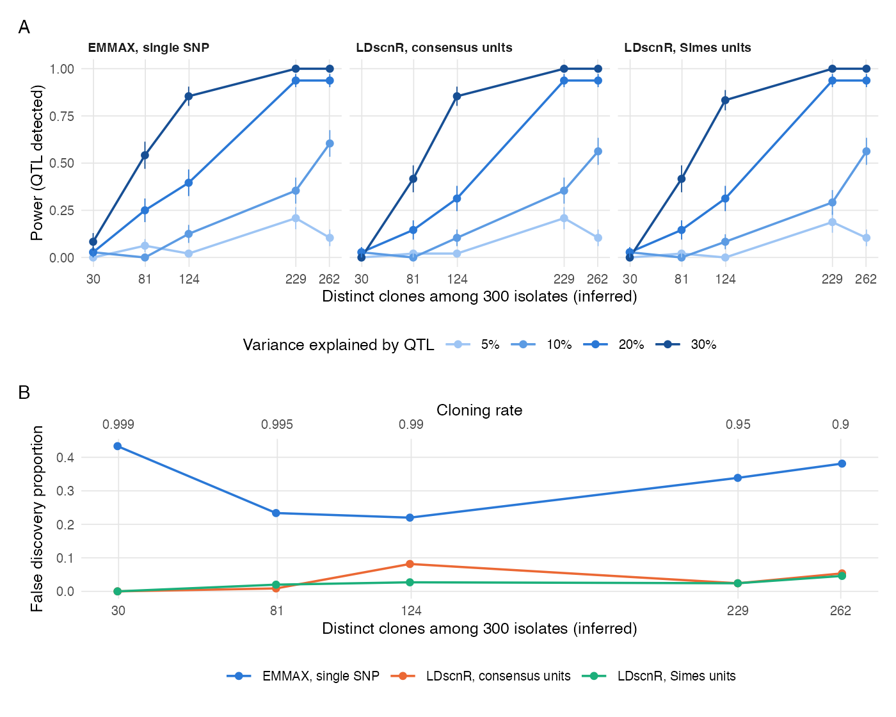

# GWAS power in a facultatively clonal pathogen: *Saprolegnia parasitica*

Simulation-based power analysis for genome-wide association studies of the oomycete fish
pathogen *Saprolegnia parasitica*, written for a Research Council of Finland application (2026).
It combines forward simulation in SLiM of a facultatively clonal diploid metapopulation, a
two-stage sequencing design (shallow sequencing to identify clones, deep sequencing of one
isolate per clone), and association scans with [LDscnR](https://github.com/genomeinsights/LDscnR)
and EMMAX.



## Requirements

- [SLiM](https://messerlab.org/slim/) >= 5.0
- Python 3 with `msprime` >= 1.3 and `tskit` (set `PY=/path/to/python` if not on `python3`)
- R >= 4.3 with `data.table`, `SNPRelate`, `ggplot2`, `patchwork` and
  [`LDscnR`](https://github.com/genomeinsights/LDscnR) 0.9.0 (`pak::pak("genomeinsights/LDscnR")`)

## Reproduce

```bash
cat out/grid.txt | xargs -P 6 -n 2 ./run_one.sh   # 60 replicates, ~2 min each per core
Rscript R/pool_and_plot.R                          # summaries + figure
```

Per-replicate results are in `out/res/`, pooled summaries in `out/summary_*.csv`.

## Pipeline

| Step | File |
|---|---|
| SLiM model: 4 x 15.75 Mb chromosomes (63 Mb), 4 sites x 1000, island migration 0.005, cloning rate C, mitotic LOH (1% of clonal births, Exp tract mean 100 kb), 4000 generations, 75 isolates sampled per site | `slim/clonal_metapop.slim` |
| Recapitation (msprime, sexual ancestral population of 4000), neutral mutations mu = 3e-8, r = 1e-8 | `py/ts_to_geno.py` |
| Two-stage design, phenotypes, LDscnR + EMMAX, scoring | `R/analyse_rep.R` |
| One replicate end to end | `run_one.sh C REP` |
| Pool + figure | `R/pool_and_plot.R` -> `figures/gwas_power_clonal.{pdf,png}`, `out/summary_*.csv` |

Grid: C in {0.9, 0.95, 0.99, 0.995, 0.999} x 12 replicates (`out/grid.txt`). Each replicate
is scanned for 16 phenotypes (4 effect sizes x one QTL on each chromosome).

Design details:
- Stage 1: all 300 isolates at ~2x (Poisson depth, 1% error). Single-read IBS distances
  corrected for each isolate's own read-pair mismatch, average-linkage clusters below 0.25
  of the median distance = clones. Clone recovery: ARI 0.95-0.99.
- Stage 2: one random isolate per inferred clone at ~15x; genotypes called from likelihoods
  (call error ~0.35%); MAF >= 0.05 (~90k SNPs).
- Phenotype per clone: one QTL (5/10/20/30% of variance, true MAF >= 0.1), 100-SNP polygenic
  background (10%), site effect (5%), noise.
- Scans use the settings of the LDscnR simulation benchmark: GCTA GRM on stage-1 pruned markers,
  rho 0.5, size floor 2, BH alpha 0.05, stage-2 region assembly. Single-SNP EMMAX hits (BH 0.05)
  are merged within 300 kb.
- Truth: a region is true if it is on the QTL chromosome and within 100 kb of the QTL or
  contains a SNP with r2 >= 0.2 to it. Background SNPs do not count as targets.

Known limitation: at C = 0.999 (~30 clones) LD-decay fitting failed for one chromosome in
3/12 replicates (C0.999 replicates 2, 5 and 6); those replicates are omitted.

## Results (out/summary_power.csv, out/summary_fdr.csv)

| Cloning rate | Distinct clones (of 300) | Power, PVE 10% | Power, PVE 20% | Power, PVE 30% | FDP EMMAX SNP | FDP LDscnR consensus / Simes |
|---|---|---|---|---|---|---|
| 0.9   | 262 | 0.56-0.60 | 0.94 | 1.00 | 0.38 | 0.05 / 0.05 |
| 0.95  | 229 | 0.29-0.35 | 0.94 | 1.00 | 0.34 | 0.02 / 0.02 |
| 0.99  | 124 | 0.08-0.13 | 0.31-0.40 | 0.83-0.85 | 0.22 | 0.08 / 0.03 |
| 0.995 | 81  | 0.00 | 0.15-0.25 | 0.42-0.54 | 0.23 | 0.01 / 0.02 |
| 0.999 | 30  | ~0.03 | ~0.03 | 0-0.08 | 0.43 | 0 / 0 |

Power is similar across the three scans. EMMAX's false discoveries are mostly isolated
single SNPs: BH at the SNP level does not control the proportion of false *loci*, while the
LDscnR unit-level test does.

## Licence

MIT, see `LICENSE`.
